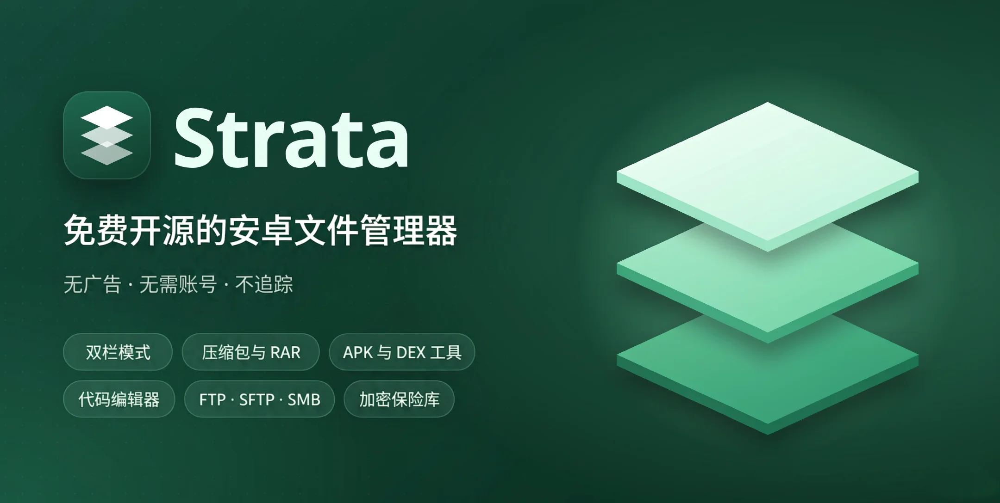

## [English](README.md) | 简体中文
<p align="center">
  
</p>

<p align="center">
  <a href="https://github.com/CluvexStudio/Strata/actions/workflows/build.yml"></a>
  <a href="LICENSE"></a>
</p>

**Strata** 是一款免费的 Android 开源文件管理器，为高级用户提供所需工具：双窗格、压缩包、APK 与 DEX 编辑、代码编辑器、网络存储以及加密保险库。无广告、无账号、无追踪。

**社区维护** → Fork 自上游 [Strata](https://github.com/CluvexStudio/Strata)。

## 功能

- **文件**：并排双窗格、拖放到文件夹、Root 与 Shizuku 访问、回收站、按名称或内容搜索、批量重命名、书签、权限、链接、拆分与合并、文件加密
- **压缩包**：打开并解压 ZIP、7z、RAR、TAR、GZ、XZ、ZST 等格式；创建带密码的 ZIP、7z 和 TAR 压缩包
- **APK 工具**：应用详情、拆分 APK 安装、签名（v1 至 v3）与签名密钥、以新名称和图标克隆、DEX 与 smali 编辑器、Java 反编译器、Manifest 与资源编辑器
- **编辑器与查看器**：带语法高亮的代码编辑器、十六进制编辑器、PDF 阅读器、图片查看器、音乐与视频播放器、字体查看器、Markdown 预览、9-patch 编辑器、颜色选择器
- **网络**：在窗格中直接使用 FTP、SFTP、SMB 和 WebDAV，还可通过 FTP 服务器或浏览器中的文件管理器进行 Wi-Fi 共享
- **代码运行器**：通过 Termux 运行并构建多种语言的代码
- **隐私**：使用指纹打开的加密保险库、应用锁，除非你主动发送，否则任何数据都不会离开你的手机
- **语言**：英语、波斯语（完全从右到左）、俄语和中文
- **设计**：Material 3 Expressive，支持动态颜色、浅色与深色主题

## 构建

你需要带有 NDK 的 Android SDK，以及安装了 Android 目标和 `cargo-ndk` 的 Rust。JDK 17 由 Gradle 配置。

```bash
rustup target add aarch64-linux-android armv7-linux-androideabi x86_64-linux-android
cargo install cargo-ndk
native/fetch-pdfium.sh
native/build.sh
./gradlew :app:assembleDebug
```

## 支持开发者

Strata 是免费开源的。如果它为你节省了时间，并且你希望帮助它成长，可以向以下地址发送捐赠。每一份支持都值得感激。谢谢！

| 支付方式 | 地址 |
|---|---|
| 支付宝 | `https://qr.alipay.com/fkx194307kvvcomtlpvu67a` |

相同的地址也位于应用内的 **设置 → 支持开发者** 中。

## 许可证

Strata 依据 [GNU AGPL v3.0 或更高版本](LICENSE) 授权。第三方组件保留其各自许可证；它们列在应用内的 **设置 → 关于** 中。